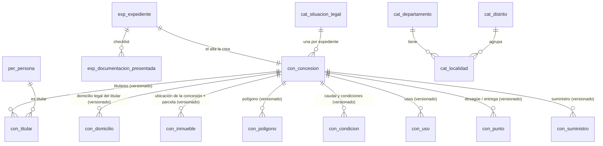

# Procesos del Backend — plan de trabajo

Bitácora de los procesos del backend (`backend/`, NestJS + PostgreSQL/PostGIS): qué está hecho, qué falta
y el detalle de cada proceso a medida que lo definimos. Se actualiza al terminar cada proceso.

La documentación técnica del backend (puesta en marcha, endpoints, PostGIS, estructura) está en
[backend/README.md](backend/README.md); el detalle de cada trámite, en el README de su carpeta
(`backend/src/tramites/<tramite>/README.md`). El estado del frontend está en
[Proyecto En React - Full/ESTADO_MIGRACION.md](Proyecto%20En%20React%20-%20Full/ESTADO_MIGRACION.md).

**Última actualización:** 08/10/2026 — ABM por la API del catálogo de suministro (zonas, fuentes/sistemas/desagües y árbol de canales) y de los ríos y canales (`sig.cauce`), con baja lógica (6.5); corregida la carga del árbol (dos canales que se perdían). Antes, 07/10/2026: revisión integral del alta (6.4).

---

## 0. Reglas de esta etapa

1. **Solo backend.** No se toca nada de `Proyecto En React - Full/` (ni código, ni `mock-server`, ni su documentación).
   El front sigue funcionando contra json-server hasta que se decida conectarlo.
2. **Mismo formato que hoy.** Todo lo nuevo sigue lo que ya está armado:
   - Cada módulo en el mismo orden: `entities` → `dto` → `service` → `controller`.
   - Nombres de tablas del esquema DRH con su prefijo (`exp_`, `con_`, `per_`, `poz_`, `emp_`, `rec_`, `seg_`, `cat_`, `mig_`).
   - Código, comentarios, endpoints y mensajes de error en **español**; los comentarios explican el proceso paso a paso.
   - Validación con `class-validator` (400 con el detalle), 409 para duplicados, 403 si actúa otra oficina.
   - Trámites en `src/tramites/<tramite>/` con su `README.md` (diagrama, tablas, reglas, estados, endpoints, pendiente)
     y su script `requests/<tramite>/circuito-completo.sh` que recorre y verifica el circuito.
   - El circuito usa lo común de `expedientes/` (tomar, pasar, actuar, historial, bandejas); no se duplica.
   - Baja lógica siempre: nada se borra, todo queda en el historial.
3. **Las respuestas sirven al front tal como está.** Antes de cerrar un proceso se compara con lo que consume la
   pantalla en json-server (`features/<…>/api.ts`, `types.ts`) y se anota acá cualquier diferencia de forma.
4. Usuario que actúa: el de la sesión (login, ver «Login, roles y permisos»). Cada acción que modifica datos lleva
   `@RequierePermiso(...)`. El encabezado `X-Usuario-Id` queda solo para tests y scripts (`AUTH_ENCABEZADO_PRUEBAS=true`).

---

## 1. Resumen rápido

| Área | Backend | Front (json-server) |
| --- | --- | --- |
| Base: NestJS, TypeORM, PostgreSQL 17 + PostGIS 3.6 en Docker, health | ✅ Hecho | — |
| Módulos base: `seguridad`, `personas`, `recaudacion`, `catalogos`, `expedientes`, `concesiones` | ✅ Hecho (sin login) | — |
| SIG: KML/GeoJSON, validación PostGIS, POSGAR 07, vistas `sig.v_concesiones` / `sig.v_pozos` / `sig.v_puntos`, cauces, QGIS | ✅ Hecho | ✅ |
| Migración del padrón (importador, lotes, datos demo) | ✅ Hecho (falta el padrón real) | — |
| **Alta de Concesión** — circuito completo; tablas con historial y carga reorganizada por pasos (6.1); oficinas como servicios reutilizables, aviso de deuda por correo y N° de concesión pedido a Catastro (6.3); revisión integral: archivo, visor, suministro contra el catálogo, cierre (6.4) | ✅ Hecho | ✅ |
| Catálogo de suministro de riego (árbol de la DRH) en la base, con validación y vinculación de zonas (6.4) y **ABM con baja lógica** (6.5) | ✅ Hecho (78 zonas por vincular) | ✅ (mock, sin ABM) |
| Ríos y canales (`sig.cauce`) con **ABM y baja lógica** por la API (6.5) | ✅ Hecho | — |
| Catálogos de ubicación (departamentos, localidades, distritos, cuencas) con **ABM y baja lógica** (6.2) | ✅ Hecho | ✅ (mock, sin ABM) |
| **Baja de Pozo** — de oficio y a solicitud | ✅ Hecho | ⏳ |
| Pozos (tabla, importación, búsqueda, ficha, capa) | 🟡 Parcial | ⏳ |
| Empresas perforadoras | 🟡 Solo alta y lectura | ✅ Circuito completo |
| Concesiones vigentes (buscador + ficha + historial) | ❌ | ✅ |
| Cambio de Titularidad | ❌ | ✅ |
| Anulación | ❌ | ✅ |
| Reducción / Ampliación | ❌ | ✅ |
| Subdivisión | ❌ | ✅ |
| Reubicación | ❌ | ⏳ |
| Permisos | ❌ | ⏳ |
| Pozo: autorización / registro | ❌ | ⏳ |
| Carga en padrón de Rentas | 🟡 Solo dentro del Alta | ⏳ |
| Búsqueda Catastro / consulta de expediente | 🟡 Historial de expediente | ✅ |
| Avisos en vivo (SSE) | ❌ | ✅ (mock) |
| Login / roles | ✅ Login, sesiones, roles y permisos por oficina, ABM de usuarios | ✅ |
| Migraciones de base (reemplazar `DB_SYNCHRONIZE`) | ❌ | — |

---

## 2. Lo que ya está hecho

### 2.1 Infraestructura

- `docker compose up -d` → PostgreSQL + PostGIS en `localhost:5433`; API en `http://localhost:3000/api`.
- `DB_SYNCHRONIZE=true` crea las tablas desde las entidades (solo desarrollo).
- `ArchivosService` guarda archivos subidos en `STORAGE_DIR` (hoy se usa para los KML originales).
- Pruebas: `npm run test:e2e` y los scripts `requests/*/circuito-completo.sh`.

### 2.2 Módulos base

| Módulo | Tablas | Qué resuelve |
| --- | --- | --- |
| `seguridad/` | `seg_oficina`, `seg_usuario` | Oficinas y usuarios de prueba; `@UsuarioActual` lee `X-Usuario-Id` |
| `personas/` | `per_persona` | Titulares únicos por documento; `GET /api/personas?documento=` |
| `recaudacion/` | `rec_deuda` | Deudas de las concesiones y sus titulares (sí / no); cancelar reanuda los expedientes en espera |
| `catalogos/` | `cat_situacion_legal`, `cat_documento_requerido`, `cat_tipo_uso` | Situaciones legales con su documentación y tipos de uso con dotación (con seed) |
| `expedientes/` | `exp_expediente`, `exp_movimiento`, `exp_actuacion`, `exp_resolucion`, `exp_documentacion_presentada` | Circuito común: tomar, pasar, actuar, historial, bandejas |
| `concesiones/` | `con_concesion`, `con_titular`, `con_domicilio`, `con_inmueble`, `con_uso`, `con_suministro`, `con_poligono`, `con_punto` | La concesión y sus partes; polígono vigente + histórico; caudal; duplicados |

### 2.3 Alta de Concesión — ver [README](backend/src/tramites/alta-concesion/README.md)

Carga en 6 pasos → Recaudación (con/sin deuda, espera y reanudación) → Distrito → Jurídico (apto / observado /
no apto) → Secretaría General (N° de concesión + resolución) → cierre en Catastro → espera del padrón → finalizado.
Script con 49 verificaciones.

### 2.4 Baja de Pozo — ver [README](backend/src/tramites/baja-pozo/README.md)

De oficio (en el acto) y a solicitud (mesa de entrada → antecedentes → evaluación técnica → Jurídico → Secretaría
→ clausura física). Distrito solo toma conocimiento.

### 2.5 SIG y migración — ver [docs/qgis.md](backend/docs/qgis.md) y [docs/migracion.md](backend/docs/migracion.md)

---

## 3. Procesos a detallar

Orden propuesto (se puede cambiar). Cada proceso se completa con la **plantilla de la sección 5** antes de
programarlo, y recién después pasa a su carpeta en `src/tramites/` con su README.

| # | Proceso | Estado | Notas |
| --- | --- | --- | --- |
| 1 | Concesiones vigentes: búsqueda paginada, ficha e historial de la concesión | ⏳ Por detallar | Base de todos los trámites sobre una concesión. El front pide de a 20 y nunca la lista completa |
| 2 | Cambio de Titularidad | ⏳ Por detallar | El nuevo titular es una propuesta hasta el cierre; `con_titular.vigente` |
| 3 | Anulación | ⏳ Por detallar | Baja lógica con motivo obligatorio |
| 4 | Reducción / Ampliación | ⏳ Por detallar | Polígono nuevo, recálculo de caudal, superficie anterior al histórico |
| 5 | Subdivisión | ⏳ Por detallar | Varias concesiones nuevas, un N° por fracción, la madre queda «subdividida» |
| 6 | Reubicación | ⏳ Por detallar | Ubicación anterior al histórico |
| 7 | Empresas perforadoras: circuito Jurídico → Secretaría, observar/rechazar, modificación, bajas, máquinas, historial | ⏳ Por detallar | En el front ya está completo |
| 8 | Pozo: autorización y registro | ⏳ Por detallar | RN-10: solo empresas activas con máquina válida |
| 9 | Permisos | ⏳ Por detallar | |
| 10 | Carga en padrón de Rentas (pantalla propia, para todos los trámites) | ⏳ Por detallar | |
| 11 | Búsqueda Catastro y consulta de expediente | ✅ Búsqueda (`GET /api/expedientes/buscar`) | Falta la búsqueda por concesión / datos catastrales |
| 12 | Avisos en vivo (SSE) | ⏳ Por detallar | |
| 13 | Login, roles y auditoría | ✅ Login, roles y permisos · ⏳ auditoría | Ver «Login, roles y permisos» |

---

## 4. Deuda técnica conocida

1. **Migraciones**: pasar de `DB_SYNCHRONIZE` a migraciones de TypeORM (ya dio problemas con esquemas de vistas y CHECKs).
   **Ya bloquea:** una base con el esquema anterior a 6.1 no arranca (`DROP TYPE con_caracter` falla porque
   `con_condicion` usa el mismo tipo). Para probar se usó otra base (`drh_nuevo`) en el mismo contenedor (6.4.5).
2. **Archivos adjuntos** al expediente: informe de Distrito, dictamen, resolución firmada, actas, fotos de máquinas.
3. **«Soltar» un expediente tomado** por otra persona de la misma oficina.
4. **Catálogos** (`cat_`) con sus FKs; la documentación de baja de pozo (`DOCUMENTOS_BAJA`) es provisoria.
5. **Cancelar un trámite ya enviado** y **«observar y devolver» en el cierre**: no existen en ningún trámite.
6. Padrón real: convertir la planilla e importarla; asociar polígonos después. Antes, resolver las localidades que
   no coinciden con el catálogo (6.1.8).
7. **Auditoría** (`seg_auditoria`): cada cambio de campo con quién, cuándo, valor anterior y nuevo. Junto con el login.

---

## 5. Plantilla para detallar un proceso

Copiar debajo de la sección 6 y completar juntos antes de programar.

```markdown
### 6.x <Nombre del proceso>

**Qué es:** una o dos líneas.
**Quién lo inicia:** oficina · **Parte de:** expediente en papel / concesión / pozo / empresa.

**Circuito:**
OFICINA → OFICINA → … → FINALIZADO   (con observado, en espera, rechazo)

| Paso | Oficina | Qué se hace | Validaciones | Endpoint |
| --- | --- | --- | --- | --- |

**Reglas:**
- …

**Estados:** (del trámite, del expediente y de la entidad afectada)

**Tablas:** nuevas / que se modifican, y qué queda en el histórico.

**Lo que consume el front hoy:** archivos de `features/…` y forma de los datos; diferencias a resolver.

**Dudas para la oficina:**
- …

**Prueba:** `requests/<tramite>/circuito-completo.sh` — casos a cubrir.
```

---

## 6. Detalle de los procesos

### 6.1 Alta de Concesión — diseño de la base de datos

> **Estado:** base de datos y carga en Catastro hechas (07/10/2026), con las decisiones de 6.1.6. Pendientes:
> D7 (adjuntos), la auditoría y lo que hay que revisar con la DRH (6.1.8). Lo que sigue es el circuito por las oficinas.
> El circuito por las oficinas ya funciona y está en [su README](backend/src/tramites/alta-concesion/README.md);
> acá se rediseña **cómo se guardan los datos** pensando en lo que va a cambiar después (titulares, domicilios,
> parcela, polígono, usos, caudal).

**Qué es:** el registro de una concesión nueva de uso de agua. **Quién lo inicia:** Catastro, con el expediente en papel.
La primera pasada por Catastro es una **carga preliminar**; recién con eso empieza el circuito.

**Lo que pide la DRH** (web oficial, «Solicitud de empadronamiento», Dpto. Catastro, Brígido Terán 636):
formulario de datos del solicitante (F.I), formulario de solicitud (F.III), F.924 DGR, **plano de empadronamiento
(4 copias en papel + copia digital)**, planilla DIAF e **informe de registro inmobiliario** actualizado. Lo puede
presentar el **titular o un apoderado/representante** que acredite la representación. Marco: Leyes 7139 y 7140.

#### 6.1.1 Criterio general: cómo se conserva el historial

Una concesión dura décadas: cambia de titular, de domicilio, se amplía, se subdivide, se reubica. Se usan dos mecanismos:

1. **Versiones por trámite** (para lo que tiene valor legal): cada bloque que un trámite puede cambiar se guarda en
   filas con `vigente`, `desde`, `hasta` y **`expediente_id`** (el trámite que lo creó). Un cambio nunca pisa la fila:
   cierra la vigente (`vigente = false`, `hasta`) e inserta la nueva. Así se puede responder «¿cómo era esta
   concesión el 10/03/2031 y qué expediente la cambió?».
   - Ya funciona así: `con_titular`, `con_poligono`, `con_uso`.
   - **Se suman:** `con_domicilio`, `con_inmueble` (parcela), `con_suministro`, `con_punto` y las condiciones del
     derecho (caudal, carácter, servicio, período), que hoy están sueltas en `con_concesion` y se pisan.
2. **Auditoría** (`seg_auditoria`, ya prevista en el modelo original): **cada** cambio de campo, con quién, cuándo,
   valor anterior y nuevo. Cubre lo que no se versiona (por ejemplo, corregir el teléfono de una persona).

**Mientras el alta está en carga** (todavía no se otorgó), lo cargado es una propuesta del mismo expediente:
se reemplaza al guardar, pero cada reemplazo queda en la auditoría. Las versiones nuevas aparecen recién con los
trámites posteriores (cambio de titularidad, reubicación…).

#### 6.1.2 Diagrama



#### 6.1.3 Tablas, sección por sección

**Paso 1 — Inicio (expediente + situación legal + checklist)**

| Tabla | Campos | Cambio respecto de hoy |
| --- | --- | --- |
| `exp_expediente` | `numero`, `reparticion` (332 por defecto, editable), `anio`; único por el trío | Sin cambios |
| `exp_documentacion_presentada` | expediente + documento del checklist | Sin cambios |
| `con_concesion.situacion_legal_codigo` | Titular de dominio / Poseedor / Tenedor: **una por expediente** (D1) | Sin cambios |
| `cat_situacion_legal` + `cat_documento_requerido` | las situaciones y los papeles que exige cada una | Sin cambios |
| `exp_documento` | adjuntos escaneados (plano de empadronamiento, informe de registro inmobiliario…) | **Pendiente (D7)**: no se hace por ahora |

**Paso 2 — Titulares y domicilios**

| Tabla | Campos | Notas |
| --- | --- | --- |
| `per_persona` | `tipo_persona`, `tipo_documento`, `documento` (único), `apellido`, `nombre`, `fecha_nacimiento` / `razon_social`, `fecha_constitucion`, `email`, `telefono` | Una sola persona por documento en todo el sistema. Los cambios de sus datos van a la auditoría |
| `con_titular` | `concesion_id`, `persona_id`, `orden` (0 = principal), `vigente`, `desde`, `hasta`, **`expediente_id`** | Se agrega el expediente que lo dio de alta o de baja. **Sin porcentaje** (D4): la tasa se cobra a la concesión entera |
| `con_domicilio` | **domicilio legal del titular** declarado en el expediente: `concesion_id`, `orden` (0 = «Domicilio legal», el resto adicionales), `calle`, `numero`, `departamento_id`, `localidad_id`, `distrito_id`, `vigente`, **`desde`**, **`hasta`**, **`expediente_id`** | Pasa a catálogos (ids en lugar de texto) y a versionado. **No es la ubicación de la concesión** (esa va en `con_inmueble`) |

Una persona puede ser titular única de una concesión y cotitular de otra: cada concesión tiene su lista
de `con_titular` apuntando a la misma `per_persona`.

> El front carga los domicilios en una lista aparte de los titulares, sin decir de cuál es cada uno. Por eso se
> guardan en la concesión. Si más adelante se quiere un domicilio por titular, hay que cambiar el formulario.

**Paso 3 — Ubicación + polígono**

| Tabla | Campos | Notas |
| --- | --- | --- |
| `con_inmueble` | `departamento_id`, `localidad_id`, `distrito_id`, `cuenca_id` + catastral + registral (pasos 4) + `vigente`, `desde`, `hasta`, `expediente_id` | **Deja de ser 1 a 1**: una reubicación o una subdivisión crean una versión nueva y la anterior queda |
| `con_poligono` | `geom` MultiPolygon EPSG:5345, `superficie_ha`, `perimetro_m` (calculados por PostGIS), `origen`, `expediente_id`, archivo original (nombre, ruta, sha256), **`sistema_origen`**, `vigente`, `hasta` | Ya versionado. Se agrega en qué sistema vino el archivo. **Opcional** (D6) |

La pestaña Ubicación es la **ubicación de la concesión**: departamento, localidad y distrito son obligatorios;
el KML/GeoJSON es **optativo**. Hoy el backend lo exige al guardar la pestaña y al enviar a Recaudación: hay
que cambiar esas dos reglas.

**Paso 4 — Catastral y registral:** quedan en `con_inmueble` (`padron`, `matricula_catastral`, `circunscripcion`,
`seccion`, `parcela`, `lamina`, `orden`; `libro`, `folio`, `anio_dominio`, `matricula_dominio`, `serie`). El padrón
lo asigna Rentas en el cierre. Circunscripción y sección siguen como listas fijas (I–III, A–H).

**Paso 5 — Usos**

| Tabla | Campos | Notas |
| --- | --- | --- |
| `con_condicion` **(nueva)** | `caracter`, `codigo_servicio`, `periodo_inicio`, `periodo_fin`, `caudal_lps`, `vigente`, `desde`, `hasta`, `expediente_id` | Sale de `con_concesion`: el caudal asignado cambia con una ampliación o una reducción y hoy se pisa |
| `con_uso` | `tipo_uso_codigo`, `magnitud`, `caudal_lps` (congelado al cargar), `vigente`, **`desde`**, **`hasta`**, **`expediente_id`** | Se completa el versionado |
| `con_punto` | `tipo` (`DESAGUE` / `ENTREGA`), `coord_x`, `coord_y` (POSGAR), `latitud`, `longitud` (las calcula PostGIS), **`geom` Point 5345**, `referencia`, `vigente`, `desde`, `hasta`, `expediente_id` | Se agrega la geometría para verlo en QGIS y buscarlo por zona |

**Paso 6 — Suministro**

| Tabla | Campos | Notas |
| --- | --- | --- |
| `con_suministro` | `fuente_principal`, `fuentes_adicionales`, `sistema_distribucion`, `canal_principal` … `canal_quinto`, `desague`, `observacion`, `vigente`, `desde`, `hasta`, `expediente_id` | Deja de ser 1 a 1 (versionado). Más adelante sus valores se validan contra `cat_suministro` (el catálogo del front, por departamento / localidad / distrito) |

**Catálogos de ubicación** ✅ (hechos el 07/10/2026): `cat_departamento` (17), `cat_localidad` (1.028, cada una con
su departamento y su distrito), `cat_distrito` (I a VII) y `cat_cuenca` (20, **a confirmar con la DRH**). En los datos,
cada localidad tiene un solo distrito, así que el distrito es una columna de la localidad. Si algún día una localidad
tiene dos, se pasa a una tabla intermedia.

- Se cargan solos al arrancar la API, si están vacíos, desde `backend/recursos/catalogos/` (copia normalizada de
  `localidadesDistritos.json` del front).
- `GET /api/catalogos/ubicaciones` devuelve **exactamente** lo que hoy sirve json-server en `/catalogoLocalidades`
  (verificado: mismo contenido y mismo orden). `GET /api/catalogos/cuencas` devuelve las cuencas.
- `UbicacionesService.exigirUbicacion(nombres)` valida departamento → localidad → distrito y avisa qué nivel falla.
  Se va a usar cuando `con_domicilio` y `con_inmueble` pasen a guardar ids (paso 3 del orden de trabajo).
  **La API sigue recibiendo y devolviendo los nombres**, como hoy; el backend los traduce a ids.

#### 6.1.4 El archivo del polígono: KML, GeoJSON y DWG

Lo que encontré en `Sistema-DRH/Archivos de referencia de concecion/`:

- `c.2480.dwg`: **AutoCAD 2013** (`AC1027`). Es lo que produce la oficina.
- `C.2480.geojson`: el mismo polígono, con `crs` **EPSG:5345** (POSGAR 2007 faja 3), propiedades `{"concesion": "2480"}`.
  Por eso funcionó perfecto.

**Sobre el KML:** sí trae coordenadas, pero el estándar KML exige latitud/longitud. Cuando el dibujo está en POSGAR
(metros) y se exporta a KML sin reproyectar, el archivo queda con números que ningún visor ubica, o el programa
directamente no lo exporta. El backend ya reconoce ese caso, pero la fuente natural de la oficina es el DWG.

**Propuesta:**
1. **GeoJSON como formato recomendado:** declara el sistema de coordenadas y se exporta de QGIS o de AutoCAD Map.
   Se respeta el `crs` del archivo, en lugar de adivinarlo por el tamaño de los números. **Hecho (6.4).**
2. **KML se sigue aceptando**, porque lo usan Google Earth y los GPS.
3. **DXF** (AutoCAD → Guardar como DXF, formato abierto) se puede sumar después. El **DWG** es un formato
   cerrado y no se puede leer directo desde Node sin un conversor externo. Hasta entonces, se convierte en QGIS.
4. Si el GeoJSON trae la propiedad `concesion` (como el de la DRH), se compara con el número de concesión y se avisa
   si no coincide. **Hecho (6.4)**: también avisa si es el número de otra concesión ya registrada.

#### 6.1.5 Organización del código (cuando se apruebe el diseño)

```
tramites/alta-concesion/
├── dto/                               forma de los datos que llegan (class-validator)
├── validaciones/                      funciones chicas y puras, una regla cada una (testeables sin base)
│   ├── expediente.validaciones.ts     exigirAnioEnCurso, exigirDocumentosDeLaSituacion…
│   ├── titulares.validaciones.ts      exigirDocumentosSinRepetir, exigirUnTitularPrincipal…
│   └── usos.validaciones.ts           exigirPeriodoValido, exigirPuntoDeEntregaSiCorresponde…
├── pasos/                             un service por pestaña
│   ├── paso1-inicio.service.ts
│   ├── paso2-titulares.service.ts
│   ├── paso3-ubicacion.service.ts
│   ├── paso4-inmueble.service.ts
│   ├── paso5-usos.service.ts
│   └── paso6-suministro.service.ts
├── alta-circuito.service.ts           circuito por las oficinas (ya existe)
├── alta-concesion.respuesta.ts        arma la respuesta para el front (misma forma que hoy)
└── alta-concesion.controller.ts
```

Variables y funciones en español, y cada función cuenta su proceso con comentarios numerados:

```ts
async iniciarAlta(datos: IniciarAltaDto, usuarioId: string) {
  //1.- Comienza el trámite: lo registra un usuario de Catastro.
  const usuario = await this.usuarios.exigirDeOficina(usuarioId, Oficina.CATASTRO);

  //2.- Se valida que el expediente sea del año en curso.
  exigirAnioEnCurso(datos.expediente.anio);

  //3.- Se valida que los papeles marcados correspondan a la situación legal elegida.
  const situacion = await this.catalogos.obtenerSituacionLegal(datos.situacionLegal);
  exigirDocumentosDeLaSituacion(situacion, datos.documentacionPresentada);

  //4.- Se crea todo junto (expediente, concesión en trámite y checklist) en una transacción.
  ...
}
```

#### 6.1.6 Decisiones

| # | Pregunta | Decisión (06/10/2026) |
| --- | --- | --- |
| D1 | Situación legal (dominio / poseedor / tenedor): ¿por expediente o por titular? | **Una por expediente**: el expediente trata de una sola concesión |
| D2 | ¿Se registra quién presenta (apoderado o representante)? | **No.** No se habló con la oficina: no se toca |
| D3 | Domicilios | **Dos cosas distintas:** domicilio legal del titular (`con_domicilio`) y ubicación de la concesión, donde va el KML (`con_inmueble` + `con_poligono`) |
| D4 | ¿Porcentaje entre titulares? | **No.** A la DRH no le importa: la tasa se cobra a la concesión entera |
| D5 | ¿El expediente siempre es del año en curso? | **Sí** (como hoy) |
| D6 | ¿Polígono obligatorio en la carga preliminar? | **Optativo** |
| D7 | ¿Adjuntar escaneos desde el alta? | **Pendiente**: no se hace por ahora |
| D8 | Formato del polígono | GeoJSON recomendado + KML; DXF después (ver 6.1.4) |

#### 6.1.7 Orden de trabajo propuesto

1. ~~Cerrar las decisiones D1–D8.~~ Hecho (D7 queda pendiente).
2. ~~Catálogos de ubicación (`cat_departamento`, `cat_localidad`, `cat_distrito`, `cat_cuenca`) con su carga inicial.~~
   Hecho el 07/10/2026, con pruebas en `test/ubicaciones.e2e-spec.ts`.
3. ~~Entidades nuevas o versionadas, con los datos de prueba (`demo:cargar`) adaptados.~~ Hecho el 07/10/2026.
4. ~~Reorganizar el código del alta en `validaciones/` y `pasos/`, paso por paso, con los comentarios numerados.~~ Hecho.
5. ~~Verificar que las respuestas sigan con la misma forma para el front y que `circuito-completo.sh` pase.~~ Hecho (ver 6.1.8).
6. ~~Actualizar el README del alta y este documento.~~ Hecho.
7. **Pendiente:** auditoría (`seg_auditoria`, punto 2 de 6.1.1): registrar cada cambio de campo con quién,
   cuándo, valor anterior y nuevo. Va junto con el login, porque necesita el usuario real.

#### 6.1.8 Qué se hizo (07/10/2026) y qué quedó para revisar

**Hecho:**
- Base común `FilaVersionada` (`vigente`, `desde`, `hasta`) en `con_titular`, `con_domicilio`, `con_inmueble`,
  `con_condicion` (nueva), `con_uso`, `con_punto` y `con_suministro`, cada una con `expediente_id`. Una sola fila
  vigente por concesión en inmueble, condición y suministro (índices únicos parciales). `con_concesion` quedó solo
  con lo que no cambia.
- `con_domicilio` y `con_inmueble` guardan **ids del catálogo**; la API sigue recibiendo y devolviendo nombres.
- `con_punto` suma la geometría (`geom`, para QGIS) y `con_poligono` el sistema de coordenadas del archivo.
- Vista `con_v_inmueble` (inmueble vigente con nombres): la usan el visor/QGIS, pozos, personas y baja de pozo.
- Polígono **optativo** (D6): se puede guardar la ubicación y enviar a Recaudación sin KML.
- Al otorgarse (padrón de Rentas), todo lo cargado rige desde la fecha de la resolución (`fijarVigenciaDesde`).
- Código del alta reorganizado: `validaciones/` (funciones puras con 9 pruebas unitarias) y `pasos/` (un
  service por pestaña), con comentarios `//1.- …`.

**Verificado:** base recreada desde cero; `circuito-completo.sh` del alta (57 verificaciones, 3 nuevas: localidad
de otro departamento, distrito equivocado y alta sin polígono), el de baja de pozo, las pruebas e2e y las unitarias.
Se compararon 127 respuestas de la API antes y después del cambio: **misma forma**; las únicas diferencias de
contenido son las localidades que no están en el catálogo (punto siguiente) y los valores que el script genera
distintos en cada corrida.

**Para revisar con la DRH:**
1. **El catálogo de localidades puede estar incompleto.** No tiene, por ejemplo, «BELLA VISTA» (Leales), que es una
   localidad real. Con la validación nueva, el alta rechaza una localidad que no esté en el catálogo.
   → Ya se pueden agregar con el ABM (6.2): falta que la DRH revise la lista.
2. **Localidades del padrón que no coinciden con el catálogo.** En los datos de prueba, 75 de 165 concesiones traen
   una localidad que el catálogo no tiene con ese nombre (ej: «LULES / LULES», «MONTEROS / LA FLORIDA»). Esas
   concesiones se importan **sin localidad** y con un aviso en el informe del lote; el texto original queda en
   `mig_registro_origen`. Con el padrón real va a pasar lo mismo: hace falta una **tabla de equivalencias**
   (nombre del padrón → localidad del catálogo) o completar el catálogo antes de importar.
3. Las 20 cuencas del catálogo salen del padrón de prueba: confirmar la lista oficial.

### 6.2 ABM del catálogo de ubicación

> **Estado:** hecho (07/10/2026). Pedido: poder cargar, editar y eliminar (siempre con eliminación lógica)
> departamentos, localidades, distritos y cuencas, para las localidades nuevas o las que falten.

**Endpoints** (para cada catálogo: `departamentos`, `localidades`, `distritos`, `cuencas`):

| Método | Ruta | Qué hace |
| --- | --- | --- |
| GET | `/api/catalogos/<catalogo>` | Listado. Por defecto solo los activos; `?todas=true` incluye los dados de baja; `?q=` busca por nombre. Localidades: también `?departamentoId=` y `?distritoId=` |
| GET | `/api/catalogos/<catalogo>/:id` | Uno |
| POST | `/api/catalogos/<catalogo>` | Alta. Departamento y cuenca: `{ nombre }`; localidad: `{ departamentoId, nombre, distritoId }`; distrito: `{ codigo, nombre? }` |
| PUT | `/api/catalogos/<catalogo>/:id` | Modificación (mismos datos que el alta) |
| DELETE | `/api/catalogos/<catalogo>/:id` | **Baja lógica** con `{ motivo }`: `activo = false` + motivo, fecha y usuario |
| POST | `/api/catalogos/<catalogo>/:id/reactivar` | Vuelve a estar disponible |

**Reglas:**
- **Nada se borra.** La baja deja la fila con `activo = false`, `baja_motivo`, `baja_en`, `baja_usuario_id`
  (CHECK en la base: inactivo ⇒ motivo y fecha). Al reactivar se conservan los datos de la última baja.
- **Quién:** usuarios de Catastro o administradores (403 para el resto). `TODO(login)`: pasar a un permiso propio.
- **Nombres** en mayúsculas y sin espacios de más (igual que el catálogo actual). **Únicos**: departamento y
  cuenca por nombre, localidad por nombre dentro del departamento, distrito por código. Si el repetido está
  dado de baja, el 409 dice que se reactive en lugar de crear otro.
- **Lo dado de baja no se edita** (409): primero se reactiva.
- **Departamento o distrito con localidades activas no se dan de baja** (409): primero se dan de baja o se
  pasan las localidades.
- **Localidad o cuenca usada por concesiones sí se puede dar de baja:** esas concesiones la conservan; deja de
  ofrecerse en el formulario (`GET /api/catalogos/ubicaciones`) y la validación del alta la rechaza. El listado
  de localidades informa `concesionesVigentes` para decidir con el dato.
- **Renombrar** corrige el nombre en todas las concesiones a la vez (lo guardan por id). Cambiar el distrito
  de una localidad no cambia el distrito de las concesiones ya cargadas.
- Para reactivar una localidad, su departamento y su distrito tienen que estar activos.
- Toda fila del catálogo guarda autoría: `creado_usuario_id`, `creado_en`, `modificado_usuario_id`, `modificado_en`.

**Código:** `catalogos/abm/` (un service por catálogo + `abm-comun.ts` con lo compartido), `catalogos/dto/abm-ubicaciones.dto.ts`,
`catalogos/abm-ubicaciones.controller.ts`, base `FilaCatalogo` en `catalogos/entities/fila-catalogo.ts`.
**Pruebas:** `test/abm-ubicaciones.e2e-spec.ts` (12 casos). Como nada se borra, cada corrida usa nombres propios
(«… PRUEBA <sufijo>») y los deja dados de baja.

**Pendiente:** el front todavía no tiene la pantalla del ABM (cuando se conecte, usa estos endpoints).
Si hace falta, el mismo esquema sirve para los otros catálogos (situaciones legales, tipos de uso).

### 6.3 Alta de Concesión — circuito por las oficinas (servicios reutilizables)

> **Estado:** hecho (07/10/2026), con las decisiones de 6.3.4. El correo funciona en modo prueba hasta que se
> configure un servidor (D2).

**Cómo funciona (lo que contó la oficina):**

```
CATASTRO          inicia y hace la pre carga ─────────────────────────────────────────────► RECAUDACIÓN
RECAUDACIÓN       ¿el titular debe algo (Rentas u otra concesión)?
                    apto (sin deuda) ──► DISTRITO
                    no apto (con deuda) ──► queda EN ESPERA en Recaudación, sin plazo (cuando paga, sigue)
                                            + «notificar por email» al titular
DISTRITO          ¿se le puede dar agua?          apto ──► JURÍDICO      no apto ──► RECHAZADO
JURÍDICO          ¿papeles y requisitos legales?   apto ──► SECRETARÍA    no apto ──► RECHAZADO
SECRETARÍA GRAL.  el director da el visto bueno; PIDE a Catastro el N° de concesión (por el sistema)
CATASTRO          carga el N° desde su libro de concesiones («Petete») — el expediente sigue en Secretaría
SECRETARÍA GRAL.  carga la resolución (N° que lleva Secretaría, con el N° de concesión) ──► CATASTRO
CATASTRO          termina la carga de los datos y hace la verificación final
                  … 30 a 60 días … llega el N° de padrón de Rentas, se carga ──► FINALIZADO
```

**Regla de oro:** el trámite solo finaliza con el visto bueno de TODAS las oficinas (Recaudación sin deuda,
Distrito apto, Jurídico apto, N° de concesión cargado, resolución y verificación final). Si una puso «no apto», el
expediente queda RECHAZADO y ya no se puede finalizar. Se controla dos veces: por el orden de las etapas y, al
cargar el padrón, revisando el historial (`EtapaCierreService.exigirVistosBuenos`).

#### 6.3.1 Un service por oficina, compartido por todos los trámites

Las oficinas hacen lo mismo en todos los trámites de concesiones; lo que cambia es **a quién** se le verifica la
deuda y **qué pasa** con la concesión cuando se rechaza, se le asigna número, se resuelve o se finaliza. Igual que
el front (`ConfigTramite`), cada trámite entrega su configuración y las oficinas son piezas comunes:

```
tramites/circuito/                      piezas comunes del circuito (las usan todos los trámites)
├── config-tramite.ts                   ConfigTramite: lo que aporta cada trámite
├── registro-tramites.service.ts        cada trámite registra su configuración al arrancar
├── etapa-envio.service.ts              Catastro: enviar a Recaudación · reenviar después de corregir
├── etapa-recaudacion.service.ts        Recaudación: verificar deuda · notificar deuda por email
├── etapa-dictamen.service.ts           Distrito y Jurídico: apto / observado / no apto
├── numero-concesion.service.ts         Secretaría pide el N° · Catastro lo carga del libro
├── etapa-resolucion.service.ts         Secretaría: registrar la resolución y pasar a Catastro
├── etapa-cierre.service.ts             Catastro: verificación final · padrón · exigirVistosBuenos
├── solicitudes-numero.controller.ts    bandeja de pedidos de N° de Catastro
├── aviso-deuda.ts                      texto del correo de deuda (función pura)
├── dto/circuito.dto.ts                 lo que manda cada oficina (lo usa también la baja de pozo)
└── validaciones/                       reglas puras: motivo obligatorio, fecha vs. año, N° repetidos

notificaciones/                         módulo base (lo van a usar otros avisos: vencimientos, pozos…)
├── entities/email.entity.ts            not_email: cada correo (a quién, asunto, texto, expediente, estado)
└── notificaciones.service.ts           enviar(): por SMTP (nodemailer) o, sin servidor, en modo prueba

tramites/alta-concesion/
├── alta-circuito.config.ts             AltaCircuitoConfig: lo propio del alta
└── alta-circuito.service.ts            llama a cada oficina con el alta y devuelve el alta actualizada
```

**La configuración de cada trámite** (`ConfigTramite`):

| Qué aporta | En el alta |
| --- | --- |
| `personasAVerificar` | Los titulares vigentes (en un cambio de titularidad será el actual y el nuevo) |
| `validarCarga` | Los 6 pasos completos y sin duplicados (matrícula o polígono) |
| `alRechazar` | La concesión queda DENEGADA |
| `etiquetasNumero` | Ninguna: un solo número (una subdivisión pedirá uno por fracción) |
| `alAsignarNumeros` | Guarda el N° en la concesión |
| `alRegistrarResolucion` | Enlaza la resolución; su fecha es la de otorgamiento |
| `alFinalizar` | Padrón en el inmueble (sin repetir), concesión VIGENTE, todo rige desde la resolución |

Cada oficina busca la configuración por el tipo de trámite del expediente, así que un trámite nuevo solo tiene
que escribir su `ConfigTramite` y sus endpoints: el circuito ya está.

#### 6.3.2 Endpoints nuevos o que cambiaron

| Método | Ruta | Oficina | Qué hace |
| --- | --- | --- | --- |
| GET | `/api/tramites/alta-concesion/:id/recaudacion` | Recaudación | Lo que informa el sistema: los titulares, sus **otras concesiones otorgadas** (con todos sus titulares y si tienen deuda registrada) y deudas anteriores sin concesión |
| POST | `/api/tramites/alta-concesion/:id/recaudacion` `{ resultado: APTO\|NO_APTO, concesiones: [{ concesionId, tieneDeuda }], observaciones? }` | Recaudación | **Apto**: ninguna concesión con deuda ni deudas sin cancelar → pasa a Distrito (si estaba en espera, se levantan las deudas). **No apto**: al menos una concesión marcada con deuda (o una deuda anterior) y el motivo obligatorio → queda EN ESPERA en Recaudación hasta que pague. La deuda queda en la concesión y en todos sus titulares (`validarDecisionDeuda`) |
| POST | `/api/tramites/alta-concesion/:id/recaudacion/notificar-deuda` `{ observaciones? }` | Recaudación | Un correo a cada titular con deuda pendiente que tenga correo cargado, con el detalle de SUS deudas. Devuelve a quién se mandó y quién no tiene correo |
| GET | `/api/expedientes/:id/emails` | — | Los correos que se mandaron por el expediente |
| POST | `/api/tramites/alta-concesion/:id/numero-concesion` | Secretaría | **Cambió:** ahora **pide** el número a Catastro (no lo asigna). Pedirlo dos veces no crea otro pedido |
| GET | `/api/solicitudes-numero?estado=PENDIENTE&expedienteId=` | Catastro | Bandeja de pedidos (pendientes primero) |
| GET | `/api/solicitudes-numero/ultimo-numero` | Catastro | Referencia: el último N° de concesión registrado |
| POST | `/api/solicitudes-numero/:id/asignar` `{ numeros: ["4521"] }` | Catastro | Carga el N° del libro: solo números, sin ceros a la izquierda, sin repetir y sin usar. El expediente sigue en Secretaría |
| POST | `/api/tramites/alta-concesion/:id/resolucion` | Secretaría | **Cambió:** exige que Catastro ya haya cargado el número |

La respuesta del alta suma `concesion.solicitudNumero` (`PENDIENTE` / `ASIGNADA`) para que Secretaría vea si
Catastro ya cargó el número. El resto de la respuesta no cambió.

**Tablas nuevas:** `exp_solicitud_numero` (pedido: expediente, estado, etiquetas, números, quién pidió y cuándo,
quién cargó y cuándo; un solo pedido pendiente por expediente) y `not_email`.

**Correo (D2):** se configura en el `.env` (`SMTP_HOST`, `SMTP_PUERTO`, `SMTP_SEGURO`, `SMTP_USUARIO`, `SMTP_CLAVE`,
`SMTP_REMITENTE`; ver `.env.example`). Sin `SMTP_HOST` cada correo queda en `not_email` como `NO_ENVIADO_PRUEBA`
y no sale a nadie. Si el servidor falla, queda `ERROR` con el motivo (no corta el trámite).

#### 6.3.3 Verificado (07/10/2026)

`circuito-completo.sh` del alta: **65 verificaciones** (8 nuevas: aviso de deuda, permisos del aviso, pedido del
número, pedido repetido, resolución antes del número, número cargado por quien no es Catastro, cantidad de números
y asignación repetida). Baja de pozo, 19 pruebas e2e y 15 unitarias (las nuevas: reglas del circuito y texto del
aviso de deuda).

> El script elige las parcelas de prueba sobre un río según la hora: después de muchas corridas puede caer sobre
> una parcela de una corrida anterior y el sistema la rechaza (bien) como duplicada. Se vuelve a correr y listo.

#### 6.3.4 Decisiones

| # | Pregunta | Decisión (07/10/2026) |
| --- | --- | --- |
| D1 | Recaudación «no apto» | Queda **en espera** en Recaudación hasta que pague, **sin plazo**. No se rechaza |
| D2 | Servidor de correo | Todavía no: queda preparado con nodemailer y funciona en modo prueba |
| D3 | N° de resolución | Lo escribe Secretaría |
| D4 | N° de concesión | Lo carga **Catastro a mano** desde su libro («Petete», ~50.000 hojas). El sistema controla que no esté usado y muestra el último registrado. Más adelante, cuando se deje el libro, el sistema lo podrá generar |
| D5 | Orden | Primero el N° de concesión, después la resolución: cuando el expediente vuelve a Catastro ya tiene las dos, aprobadas por el director |

### 6.4 Alta de Concesión — revisión integral (carga, archivo del polígono, visor)

> **Estado:** hecho (07/10/2026). El alta es la base de los demás trámites (búsqueda, cambio de titularidad,
> reducción, subdivisión…), así que se revisó entera antes de seguir: que valide todo el proceso, que el
> archivo del polígono quede bien guardado y ubicado, y que el visor muestre lo que corresponde.

#### 6.4.1 Decisiones (07/10/2026)

| # | Pregunta | Decisión |
| --- | --- | --- |
| D1 | Jurídico o Distrito observan y Catastro, al corregir, cambia los titulares: Recaudación nunca verificaba a los nuevos | **Vuelve a Recaudación**: al reenviar, si hay personas que Recaudación no verificó, pasa primero por Recaudación y con el «sin deuda» vuelve a la oficina que observó |
| D2 | ¿Qué puede cambiar Catastro en el cierre (después de la resolución firmada)? | **Solo completar.** Titulares, domicilios, ubicación, polígono, usos y caudal quedan fijos; del inmueble y del suministro se completan los campos vacíos |
| D3 | ¿Hasta cuándo puede faltar el polígono? (D6 de 6.1: optativo en la carga) | **Obligatorio para la verificación final** del cierre: toda concesión otorgada queda en el visor y en QGIS |
| D4 | Catálogo de suministro | Es el que entregaron los jefes, real: es un **árbol que tiene que existir en la base** y el paso 6 se valida contra él |

#### 6.4.2 Qué se hizo

**Archivo del polígono**
- **Sistema de coordenadas declarado.** Un GeoJSON con `crs` (QGIS lo agrega al exportar) se transforma desde
  ese sistema con PostGIS. Antes se ignoraba y el sistema se adivinaba por los números: un archivo en
  **Campo Inchauspe** (EPSG:22193, el sistema viejo) se tomaba como POSGAR 2007 y quedaba **corrido 225 m**
  en Tucumán (más que el ancho de una parcela). Si declara POSGAR o WGS84 y los números son del otro, 400.
  En `con_poligono.sistema_origen` queda `EPSG:22193` (o `POSGAR_FAJA3` / `WGS84`).
- **Número de concesión del archivo** (propiedad `concesion` de las capas de la DRH): aviso si no coincide con la
  concesión o si es el de otra ya registrada.
- **Descarga del original:** `GET /api/sig/poligonos/:id/archivo`, comprobado con su SHA-256.
- **KML para Google Earth o un GPS:** `GET /api/sig/concesiones/:id/kml` (Distrito, inspecciones).
- **Desagüe y punto de entrega lejos del polígono** (más de 1 km): aviso en el paso 5 y al cargar el polígono.

**Visor**
- `con_poligono.desde`: el polígono rige desde la fecha de la resolución, como el resto de lo cargado
  (antes quedaba con la fecha de carga). `sig.v_concesiones.poligono_desde` lo muestra (la fecha de carga
  mientras está en trámite). Es la base para reducción, ampliación y reubicación.
- Polígono obligatorio al cierre (D3): ninguna concesión vigente nueva queda fuera del visor.

**Catálogo de suministro (D4)** — `catalogos/suministro/`
- Tablas: `cat_suministro_zona` (departamento + localidad + distrito, con baja lógica), `cat_suministro_opcion`
  (fuentes, sistemas, desagües) y `cat_suministro_canal` (el **árbol**: cada canal apunta a su padre;
  principal = nivel 1 … quinto = nivel 5; CHECK del nivel; nombre único dentro del padre).
- Se carga solo al arrancar desde `recursos/catalogos/suministro.json` (copia sin tocar del archivo del front).
  Junta las dos partes del archivo que se superponen (`canalesPrincipales` y `cascada`).
- `GET /api/catalogos/suministro` devuelve el mismo formato que `/catalogoSuministro` de json-server (con
  `?departamento=&localidad=&distrito=`, solo esa ubicación).
- Paso 6: cada fuente, el sistema y el desagüe tienen que ser de la zona, y los canales un **camino del árbol**
  (el secundario deriva del principal elegido, y así hasta el quinto). Se guarda con los nombres del catálogo. Si
  la ubicación no tiene catálogo, solo observación y caudal (como hace el formulario). Se revalida al enviar y en
  la verificación final, porque la ubicación pudo cambiar después del paso 6.
- `con_suministro.fuente_principal` pasa a admitir NULL (ubicación sin catálogo: el formulario no ofrece fuentes).

**Circuito**
- D1: cada «sin deuda» guarda a quiénes verificó (`datos.personas`) y al reenviar se comparan con los titulares
  actuales. La corrección que pasa por Recaudación queda marcada (`reverificaDeuda`, `vuelveA`) y el «sin deuda»
  siguiente la manda a esa oficina (`destinoTrasVerificarDeuda`). Recaudación verifica a todos los titulares
  actuales (también a los ya verificados: pudieron sumar deudas).
- D2: `validaciones/cierre.validaciones.ts` (`exigirSoloCompletar`, `exigirSinCambios`), aplicadas en los pasos 2 a 6.

**Código nuevo:** `sig/kml/sistema-coordenadas.ts` (`sridDeclarado`), `catalogos/suministro/` (árbol en funciones
puras + service), `catalogos/entities/suministro-*.entity.ts`, `tramites/alta-concesion/validaciones/cierre.validaciones.ts`.

#### 6.4.3 Verificado (07/10/2026)

- `circuito-completo.sh` del alta: **100 verificaciones** (35 nuevas): suministro antes de la ubicación, descarga
  idéntica del original, KML de la concesión, aviso de desagüe a 44,7 km, sin avisos con los puntos dentro, fuente
  fuera de la zona, canal de otra rama, cotitular nuevo → Recaudación → vuelve a Distrito, cierre (usos, matrícula,
  polígono y caudal bloqueados; lámina y serie se completan), polígono vigente desde la resolución en el visor,
  ubicación sin catálogo (solo observación), verificación final sin polígono (400) y con el polígono cargado en el
  cierre, GeoJSON en Campo Inchauspe (corrido 225 m) y declarado WGS84 con números POSGAR (400).
- Baja de pozo (47), 19 pruebas e2e y **32 unitarias** (17 nuevas: sistema declarado, cierre, árbol de
  suministro, reverificación de deuda).
- Para que las parcelas de prueba no caigan sobre las de corridas anteriores, el script ahora también las corre
  entre 100 y 1.100 m al este según la corrida.

#### 6.4.4 Para revisar con la DRH

1. **El catálogo de suministro trae 20 líneas de la página web** mezcladas como canales secundarios
   («2. COSTO: ESTAMPILLAS PROVINCIALES $ 30», «6. E-MAIL: CATASTRO@…», «4. TELÉFONO: 0381 – 4526393»,
   «FORMULARIOS»…). Se descartan al cargar (`esTextoAjeno`, quedan en el log). **Hoy el front las ofrece como
   canales**: conviene corregir también el archivo de origen.
2. **78 zonas del catálogo de suministro no coinciden con ninguna localidad** del catálogo de ubicación. Algunas
   son el mismo lugar escrito distinto («TRANCAS» / «VILLA DE TRANCAS», «JUAN B ALBERDI» / «JUAN BAUTISTA
   ALBERDI») y otras son localidades que **faltan** en el catálogo de ubicación (CONCEPCIÓN, FAMAILLÁ, LULES,
   YERBA BUENA…). Mientras no se vinculen, esas ubicaciones no tienen opciones de suministro. Herramientas:
   `GET /api/catalogos/suministro/zonas?sinVincular=true`, `PUT /api/catalogos/suministro/zonas/:id/localidad`
   y el ABM de localidades (6.2) para agregar las que faltan. También ayuda con 6.1.8 (localidades del padrón).
3. **15 zonas «(SIN LOCALIDAD)»**: ¿valen para todo el departamento y distrito cuando la localidad no tiene zona
   propia? Hoy no se usan (el formulario tampoco las encuentra).
4. Queda un caso parecido a D1: si **Jurídico** observa y Catastro cambia el **polígono o los usos**, el expediente
   vuelve a Jurídico sin que Distrito evalúe el cambio. ¿Debería volver a Distrito?

#### 6.4.5 Base de datos de desarrollo

La base `drh_sistema` del contenedor tenía el esquema anterior a 6.1 (con 1 expediente) y `DB_SYNCHRONIZE` no puede
actualizarla (deuda técnica 1). No se tocó: se creó `drh_nuevo` en el mismo contenedor y el `.env` local apunta ahí
(`DB_NAME=drh_nuevo`), con los catálogos, los cauces y los datos de prueba cargados.

#### 6.4.6 Publicación en el mapa público (Argenmap)

Regla (pedida el 2026-10-22): el polígono de una concesión se ve en Argenmap recién cuando el expediente pasó por
Recaudación, Distrito, Jurídico y Secretaría General **con número de resolución** y alguien con el permiso
`MAPA_PUBLICAR` («Publicar en el mapa», Catastro, plantilla del Jefe) lo verificó. Los usuarios internos lo ven
siempre en el visor del sistema; lo de afuera (GeoServer, QGIS con `drh_lector_sig`) solo ve lo publicado.

- `con_poligono.publicacion`: `PENDIENTE` (al cargar) → `PUBLICADO` u `OBSERVADO` (nota obligatoria). Los migrados
  entran `PUBLICADO`. Va por fuera del circuito de oficinas: no frena la espera del padrón.
- Vistas: `con_v_mapa_concesion` y `con_v_mapa_punto` (internas, esquema public; las lee la API) y
  `sig.v_concesiones` / `sig.v_puntos` (públicas: solo `PUBLICADO`, sin documento del titular ni oficina actual).
- API `tramites/publicacion-mapa/`: `GET /api/mapa/publicacion?estado=`, `POST /:poligonoId/publicar`
  (exige resolución y que el expediente no esté rechazado/anulado/archivado), `POST /:poligonoId/observar`
  (si estaba publicado, lo retira) y `POST /:poligonoId/reemplazar` (multipart, permiso `KML_CARGAR`: Catastro
  sube el KML corregido de un observado; el anterior queda en el histórico y el nuevo vuelve a `PENDIENTE`).
- Cada acción queda en el historial del expediente: actuación `PUBLICACION_MAPA` (APTO / OBSERVADO / REGISTRADO).
- Front: Catastro → «Publicación en el mapa» (`/catastro/publicacion-mapa`); la ficha del visor avisa «Solo interno».

### 6.5 ABM del catálogo de suministro y de los ríos y canales

> **Estado:** hecho (08/10/2026). Pedido: poder agregar, corregir y dar de baja lo que haga falta del
> catálogo de suministro (zonas, fuentes, canales…) y de los ríos y canales, **solo por endpoints** por
> ahora (sin pantalla). Mismas reglas que el ABM de ubicación (6.2).

#### 6.5.1 Revisión previa del catálogo (08/10/2026)

- Los 7 distritos tienen catálogo: 250 zonas, 2.400 opciones (fuentes, sistemas, desagües) y 3.666 canales.
  El árbol más profundo llega al canal quinto: no se pierde nada por el corte en el nivel 5.
- **Corregido:** al normalizar, dos canales hermanos con el mismo nombre escrito distinto («DVDO. NORTE» y
  «DVDO.  NORTE») se pisaban y se perdían las derivaciones del primero. En TALAMUYO (VI) faltaba
  `MATRIZ > DVDO. NORTE > LOS RALOS > COMPUERTA 27 > PROPIO`. Ahora se juntan (`normalizarCatalogo`), y en
  `drh_nuevo` se agregaron esos 2 canales con el ABM nuevo.
- De las 78 zonas sin vincular (6.4.4 punto 2), **25** tienen una localidad equivalente en el catálogo de ubicación
  (TRANCAS → VILLA DE TRANCAS, LEOCADIO PAZ → LEOCADIO PAEZ…) y **53** no existen en ese departamento
  (CONCEPCIÓN, FAMAILLÁ, LULES, JUAN B. ALBERDI, CRUZ ALTA… y unas 30 que figuran en otro departamento).

#### 6.5.2 Qué se hizo

| Catálogo | Endpoints | Reglas |
| --- | --- | --- |
| Zonas | `GET/POST /api/catalogos/suministro/zonas`, `GET/PUT/DELETE …/zonas/:id`, `POST …/zonas/:id/reactivar` (y `PUT …/zonas/:id/localidad`, ya existía) | Departamento y distrito activos; la localidad (optativa), del mismo departamento y distrito y sin otra zona; el nombre de origen no se repite en el departamento y distrito. La ficha (`GET …/zonas/:id`) trae las listas y el árbol con ids |
| Fuentes, sistemas, desagües | `POST …/zonas/:id/opciones` `{ tipo, nombre }`, `PUT/DELETE …/opciones/:id`, `POST …/opciones/:id/reactivar` | Nombre único en su lista de la zona. Se rechazan los textos ajenos (`esTextoAjeno`) |
| Canales | `POST …/zonas/:id/canales` `{ nombre, padreId? }`, `PUT/DELETE …/canales/:id`, `POST …/canales/:id/reactivar` | Sin padre es principal; con padre, un nivel más (el padre de la misma zona y activo), **hasta el quinto**. Nombre único entre hermanos. La **baja se lleva las derivaciones**; la reactivación devuelve las que se dieron de baja con él (misma fecha de baja) y exige el padre activo |
| Ríos y canales | `GET/POST /api/catalogos/cauces`, `GET/PUT/DELETE /api/catalogos/cauces/:id`, `POST …/:id/reactivar` | `linea` = vértices `[x, y]` en WGS84 (`[lon, lat]`) o POSGAR 2007 faja 3 (`sistema: "POSGAR"`); se valida que los números sean del sistema indicado, que la línea sea válida y que caiga en Tucumán. PostGIS calcula el largo. Fuente por defecto `DRH` |

Comunes a todos: solo Catastro o un administrador (403); **baja lógica** con motivo (mínimo 10 caracteres);
lo dado de baja no se edita ni se vuelve a crear con el mismo nombre (409: «reactívelo»); para tocar las listas o
los canales de una zona, la zona tiene que estar activa.

**Efecto de una baja:**
- Suministro: deja de ofrecerse en `GET /api/catalogos/suministro` y el paso 6 del alta deja de aceptarla (también
  al reenviar y en la verificación final). Las concesiones ya cargadas conservan lo que tienen: el suministro se
  guarda con los **nombres**. Lo mismo al **renombrar**: un alta en trámite con el nombre viejo tiene que volver a elegirlo.
- Cauces: sale del visor (`GET /api/sig/cauces`) y del aviso del «cauce más cercano» al analizar un polígono.
- La carga de cauces desde un archivo (`cargar-cauces --fuente X`) ahora **da de baja** los anteriores de esa fuente
  en lugar de borrarlos.

**Tablas:** `cat_suministro_opcion`, `cat_suministro_canal` y `sig.cauce` suman las columnas comunes de los
catálogos (`activo`, autoría y baja, `FilaCatalogo`) con su CHECK de baja. Las filas existentes quedan activas.

**Código:** `catalogos/suministro/suministro-abm.service.ts`, `catalogos/abm-suministro.controller.ts` (también
recibió el listado y la vinculación de zonas), `catalogos/dto/suministro.dto.ts`; `sig/cauces.service.ts`,
`sig/abm-cauces.controller.ts`, `sig/dto/cauce.dto.ts`.

**Verificado (08/10/2026):** `test/abm-suministro-cauces.e2e-spec.ts` (16 pruebas nuevas: zona, listas, árbol hasta
el quinto, baja en cascada y reactivación, validación del paso 6, cauces en WGS84 y POSGAR, rechazos por
georreferencia); todas las e2e (35) y unitarias (33, una nueva por el choque de nombres); `circuito-completo.sh`
del alta: 100 verificaciones.

**Pendiente:** pantallas de administración en el front; a QGIS, la capa `sig.cauce` le muestra también los dados
de baja (filtrar `"activo" = true`).

---

## 7. Checklist para cerrar un proceso en el backend

- [ ] Proceso detallado en la sección 6 y dudas con la oficina resueltas.
- [ ] Entidades con nombres del esquema DRH; sin borrado físico.
- [ ] DTOs con `class-validator` y mensajes en español.
- [ ] Service con las reglas y transacciones; circuito con `expedientes/` (tomar, actuar, historial).
- [ ] Controller con las rutas en español bajo `/api/…`.
- [ ] Respuestas comparadas con lo que espera el front (sin tocar el front).
- [ ] `src/tramites/<tramite>/README.md` con el mismo formato que Alta y Baja de Pozo.
- [ ] `requests/<tramite>/circuito-completo.sh` pasando.
- [ ] Endpoints agregados a la tabla de `backend/README.md`.
- [ ] Este documento actualizado (resumen, estado y fecha).
- [ ] `npm run db:tablas` para regenerar `backend/docs/tablas.md`.

---

## 8. Cómo se generan las tablas

Las tablas **no se escriben a mano en SQL**. Se describen en TypeScript, en las *entidades*, y TypeORM las crea.

```
src/catalogos/entities/localidad.entity.ts          (lo que escribimos)
        │  al arrancar la API, con DB_SYNCHRONIZE=true en el .env
        ▼
TypeORM compara las entidades con la base y ejecuta el SQL que falta:
CREATE TABLE "cat_localidad" (...), ALTER TABLE ... ADD CONSTRAINT ..., CREATE INDEX ...
        ▼
PostgreSQL: la tabla cat_localidad
```

**Cómo se lee una entidad** (ejemplo real, `cat_localidad`):

| En la entidad | Lo que genera en PostgreSQL |
| --- | --- |
| `@Entity('cat_localidad')` | `CREATE TABLE "cat_localidad"` |
| `@PrimaryGeneratedColumn() id: number` | `"id" SERIAL NOT NULL` + clave primaria |
| `@Column({ length: 100 }) nombre: string` | `"nombre" character varying(100) NOT NULL` |
| `@Column({ default: true }) activo: boolean` | `"activo" boolean NOT NULL DEFAULT true` |
| `@ManyToOne(() => Departamento)` + `@JoinColumn({ name: 'departamento_id', foreignKeyConstraintName: 'fk_localidad_departamento' })` | `"departamento_id" integer NOT NULL` + `ALTER TABLE ... ADD CONSTRAINT "fk_localidad_departamento" FOREIGN KEY ("departamento_id") REFERENCES "cat_departamento"("id") ON DELETE RESTRICT` |
| `@Index('uk_localidad', ['departamento', 'nombre'], { unique: true })` | `CREATE UNIQUE INDEX "uk_localidad" ON "cat_localidad" ("departamento_id", "nombre")` |
| `nullable: true` | la columna admite NULL (sin `NOT NULL`) |
| `@Check('chk_…', 'expresión')` | `CONSTRAINT "chk_…" CHECK (expresión)` |

Convenciones: tablas con prefijo del submódulo (`cat_`, `con_`…), columnas en `snake_case` (`departamento_id`), y nombres
propios para las claves foráneas (`fk_`), los únicos (`uk_`), los índices (`idx_`) y los controles (`chk_`).

**Para ver las tablas** (con la base levantada, desde `backend/`):

| Comando | Qué deja |
| --- | --- |
| `npm run db:tablas` | [backend/docs/tablas.md](backend/docs/tablas.md): cada tabla con sus columnas, tipos, obligatorias, claves foráneas, índices y CHECKs, agrupadas por submódulo. **La forma más cómoda de revisarlas** |
| `npm run db:sql` | [backend/docs/esquema.sql](backend/docs/esquema.sql): el SQL exacto de toda la base (`pg_dump --schema-only`) |
| `DB_LOGGING=true` en el `.env` | la API muestra en la consola cada SQL que ejecuta, incluido el `CREATE TABLE` cuando crea una tabla nueva |
| `docker exec -it drh-postgres psql -U drh -d drh_sistema` y después `\d cat_localidad` | la consola de PostgreSQL, tabla por tabla |

> `DB_SYNCHRONIZE=true` sirve solo en desarrollo. Antes de producción se pasa a **migraciones**: archivos con el SQL
> de cada cambio, que se revisan y se aplican en orden (está en la deuda técnica).

---

## Login, roles y permisos (`seguridad/`)

- **Ingreso:** `POST /api/auth/login { usuario, clave }` con legajo o email. Contraseña con scrypt (`seguridad/claves.ts`,
  8+ caracteres con letras y números). Devuelve un token al azar; en `seg_sesion` se guarda solo su SHA-256. La sesión
  vence tras `SESION_HORAS` (8) sin uso. Al quinto intento fallido el usuario se bloquea 15 minutos.
- **Contraseña temporal:** el alta y el restablecimiento generan una (se muestra una vez). Con ella solo se puede ver la
  sesión, cambiarla (`POST /api/auth/cambiar-clave`) o salir (`POST /api/auth/logout`).
- **Permisos por usuario:** cada usuario tiene UNA oficina y un rol (`seg_rol`: Jefe, Operador, Solo consulta). Lo que
  puede hacer son los permisos que le asigna Informática (`seg_usuario_permiso`); cada permiso pertenece a una oficina
  (`seg_permiso.oficina_codigo`; sin oficina = general: tomar expedientes, ver datos sensibles) y solo se asigna a
  usuarios de esa oficina. El rol es una **plantilla** (`seg_rol_permiso`, `GET/PUT /api/roles/permisos`) que se precarga
  al crear el usuario o al cambiarle oficina o rol. Los códigos y la carga inicial están en `permisos.constantes.ts`
  (Catastro: crear e iniciar, editar, **cargar el KML** —aparte porque cambia el visor—, cerrar, asignar N°, catálogos).
  El administrador puede todo. Además del permiso, para actuar sobre un expediente tiene que estar en su oficina.
- **Acceso por oficina:** `@SoloOficina(...)` en lo propio de cada oficina (deudas y antecedentes → Recaudación; pedidos
  de N° → Catastro / Secretaría; avisos de baja → Distrito; bajas en trámite → Pozos); cada bandeja solo para su oficina.
  Buscar y ver un expediente es para todos.
- **Datos sensibles:** las consultas marcadas `@ConDatosSensibles()` pasan por `DatosSensiblesInterceptor`: sin el
  permiso `DATOS_SENSIBLES_VER` se enmascara el documento (últimos 3 dígitos) y se quitan domicilios, teléfono, email y
  montos / comprobantes de deudas; la respuesta lleva `datosSensiblesOcultos: true` (el front no deja editar la carga).
- **Guardia global** (`auth.guard.ts`): toda ruta exige sesión salvo `@Publico()` (login, health); controla
  `@SoloAdministrador()`, `@SoloOficina(...)` y `@RequierePermiso(...)`. Los permisos que dependen de lo que se manda
  (el KML solo si viene un archivo) se controlan en el controlador con `exigirPermiso(sesion, ...)`.
- **ABM de usuarios** (`/api/usuarios`, solo administradores): alta, modificación, baja lógica con motivo (cierra sus
  sesiones), reactivación y restablecer contraseña. El usuario «Sistema» (id 1) no se edita ni entra.
- **`.env`:** `ADMIN_CLAVE_INICIAL` crea el usuario `ADMIN`. Solo desarrollo: `CLAVE_USUARIOS_PRUEBA` (usuarios DEMO-*,
  rol Jefe) y `AUTH_ENCABEZADO_PRUEBAS=true` (tests e2e y `requests/*.sh`). Los dos se ignoran con `NODE_ENV=production`.
- **Pendiente:** auditoría de cambios (`seg_auditoria`).
